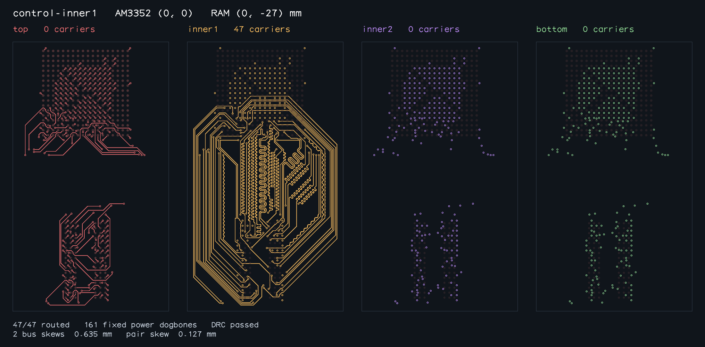
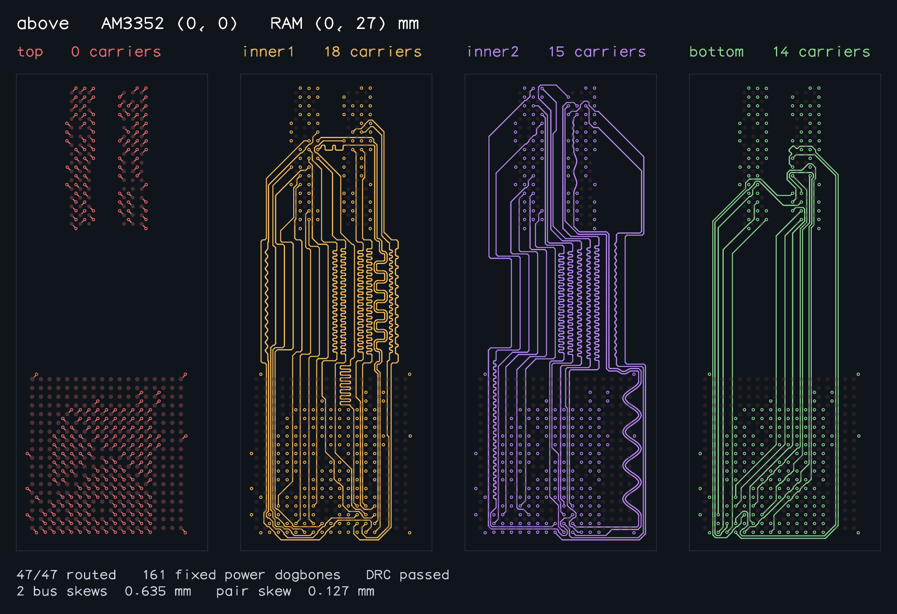
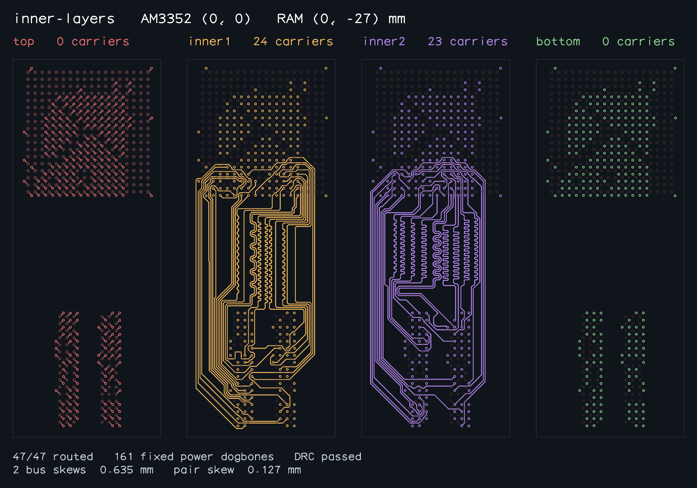
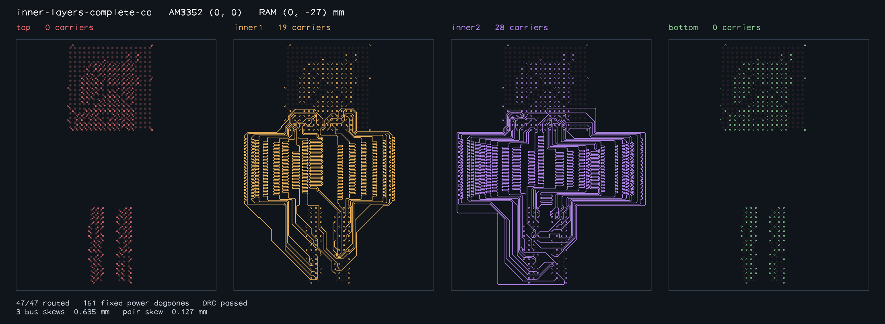

# Completed AM3352 routing samples

These images come from fresh local solves of final PR #122 production revision `acccb2b764f1246032e7e803516a7cd02cf3165b`, using the unchanged v0.0.37 benchmark harness `791e0b67fb3519a87fb296447905ccd4fafa83f8`, Bun 1.4.0 and a 3,600-second per-case budget. Three workers share the local 4-CPU container; use the paired Blacksmith run for performance comparisons. Local timings are not compared with CI timings.

Each retained route passed complete 47-signal connectivity, native copper DRC, whole-copper bus and pair length matching, shared/exterior coupling and immutable 161-trace power-fanout validation. The repository's `exportAm3352RoutedSnapshots` then independently revalidated all eleven completed outputs before rendering any image. This export validation is not another fresh solve. All four physical layers use the same scale within each board image; the lines are actual emitted copper primitives, not unrouted ratsnest or search geometry.

Fresh solve command, for each declared sample, run from the pinned base checkout with the final PR solver checkout available:

```sh
BUN_JSC_forceRAMSize=2147483648 BUN_JSC_miniVMHeapGrowthFactor=1.05 \
  ./benchmark.sh --worker "$SAMPLE" --solver /path/to/head/lib/index.ts \
  --timeout-seconds 3600 --routes-directory /path/to/accepted-routes
```

The footer shows requested skew limits; measured whole-copper values are in the manifest and benchmark table.

The manifest identifies each source revision, input hash, successful route/quality validation and PNG hash. Raw fresh paired base/head reports and logs are in [final PR #122 run 41233079222](https://github.com/tscircuit/bus-lanes-solver/actions/runs/41233079222); PR #121 is separately measured by [run 41232998067](https://github.com/tscircuit/bus-lanes-solver/actions/runs/41232998067). Baseline failure of the separate OrangeCrab byte is described in text in the PRs. Failed captures are not published.

## control


## control-inner1



## right


## left


## above



## inner-layers



## inner-layers-right


## inner-layers-left


## inner-layers-above


## inner-layers-complete-ca



## outer-layers


