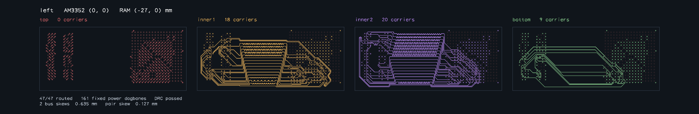
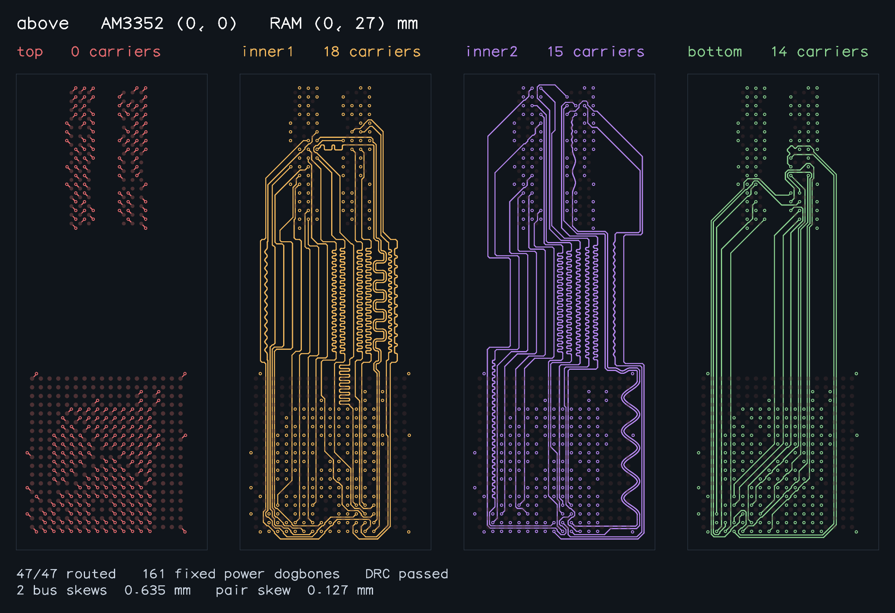
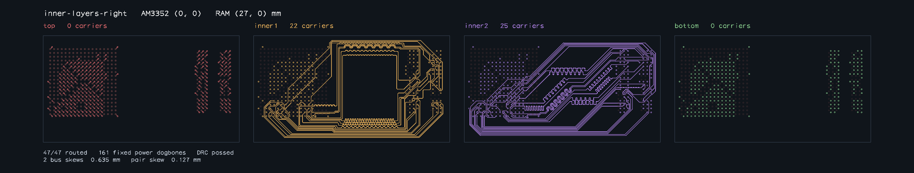
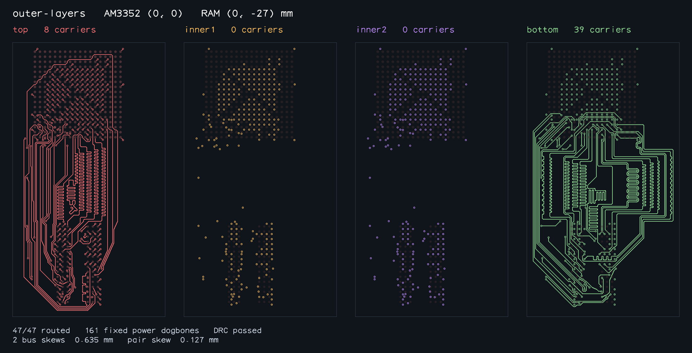

# H616 routing and AM3352 validation

These images were generated from fresh solves of all eleven AM3352 benchmark samples with the final production source recorded in the [manifest](./artifact-manifest.json). Each solve preserves its input and supplied power fanouts, connects all 47 signals, and passes physical DRC, bus skew, pair skew and coupling. The unchanged exporter validates the complete set before writing images.

Local image captures use Bun 1.4.2 on macOS arm64 with a 3,600-second solver budget. They are not paired performance measurements. The PR links the final paired Blacksmith comparison, which uses identical base/head inputs, harness, runtime, resource allocation and budgets.

| Sample | Signals | DRC and matching |
| --- | ---: | --- |
| control | 47/47 | Pass |
| control-inner1 | 47/47 | Pass |
| right | 47/47 | Pass |
| left | 47/47 | Pass |
| above | 47/47 | Pass |
| inner-layers | 47/47 | Pass |
| inner-layers-right | 47/47 | Pass |
| inner-layers-left | 47/47 | Pass |
| inner-layers-above | 47/47 | Pass |
| inner-layers-complete-ca | 47/47 | Pass |
| outer-layers | 47/47 | Pass |

Reproduce accepted images from this revision:

```sh
bun scripts/snapshot-routed-am3352.ts /tmp/h616-regression-gallery 3600
```

The H616 regression uses the unchanged Core-generated input in `tests/fixtures/h616-reference-skew/declarative.json.gz`, one phase and default solver options. It checks the original nine timing rules and six preservation limits, with no supplied signal copper.

## control


## control-inner1


## right


## left



## above



## inner-layers


## inner-layers-right



## inner-layers-left


## inner-layers-above


## inner-layers-complete-ca


## outer-layers


