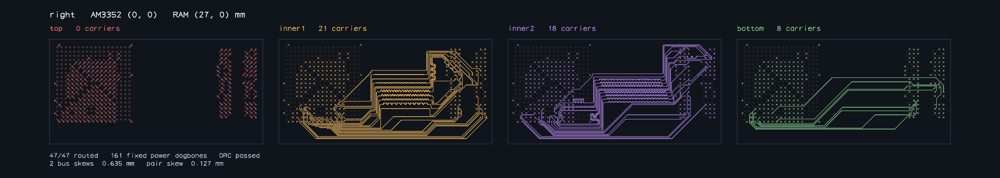
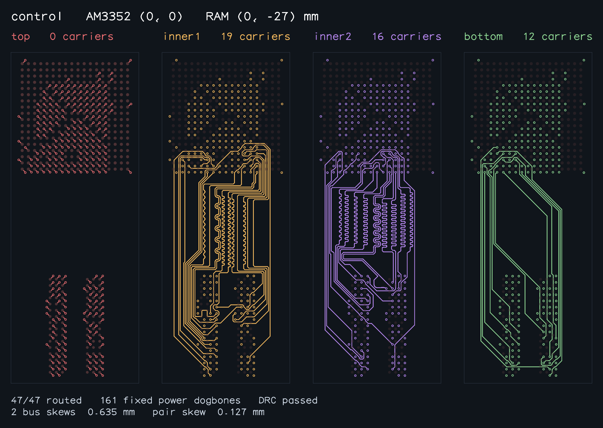
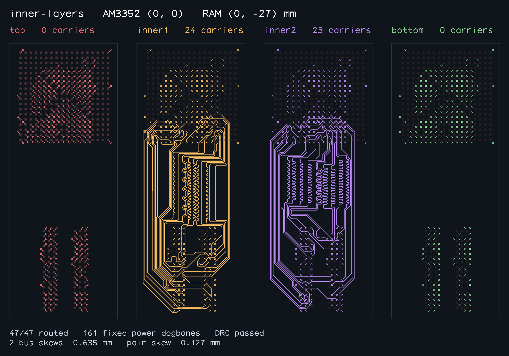
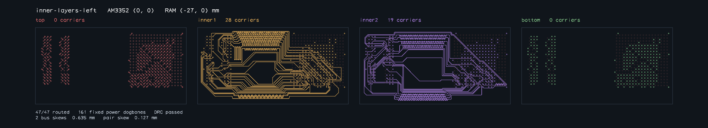
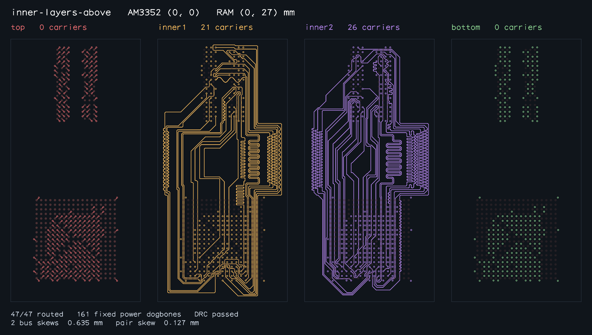
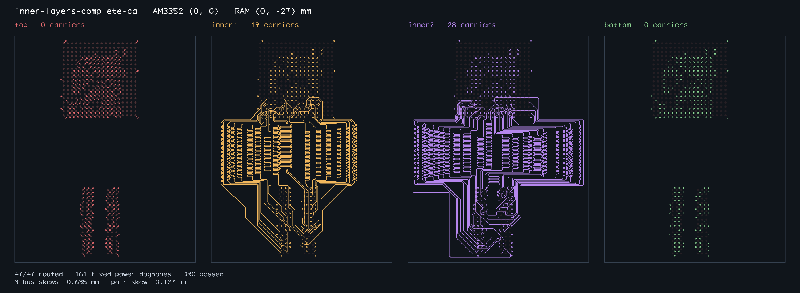
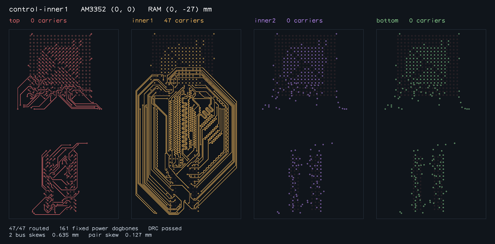

# Default range recovery validation

Fresh paired Blacksmith solves compare `78113d216f4264abcdc05f3d9fedaf556047e280` with `749ce91ea5b22fb0da583b54336804a5494f0ee9`, using the same inputs and a 3,600-second budget per solver and sample. [Raw reports and job summary](https://github.com/tscircuit/bus-lanes-solver/actions/runs/45629866162). All eleven samples pass full connectivity, fixed-copper preservation, physical DRC, bus skew, pair skew and coupling on both revisions. Every reported routing-quality field is identical. These timings do not establish a speedup.

| Sample | Base seconds | Head seconds | Quality |
| --- | ---: | ---: | --- |
| left | 24.616 | 25.403 | Identical |
| inner-layers | 33.377 | 34.740 | Identical |
| inner-layers-above | 183.866 | 176.139 | Identical |
| control-inner1 | 624.783 | 575.304 | Identical |
| inner-layers-left | 154.628 | 158.217 | Identical |
| inner-layers-complete-ca | 192.884 | 199.420 | Identical |
| control | 22.305 | 22.218 | Identical |
| right | 20.763 | 20.080 | Identical |
| above | 27.169 | 28.792 | Identical |
| outer-layers | 613.169 | 643.288 | Identical |
| inner-layers-right | 55.553 | 54.285 | Identical |

The images below come from separate fresh local solves of the same head. The unmodified exporter validated all eleven candidates before writing any images; every image was visually inspected. Local capture timings are not paired performance measurements.

Reproduce from the head revision:

```sh
bun scripts/benchmark.ts --worker SAMPLE --solver ./lib/index.ts --timeout-seconds 3600 --routes-directory /tmp/default-range-routes
bun scripts/snapshot-routed-am3352.ts /tmp/default-range-gallery 3600
```

## right



## control



## left


## above


## inner-layers



## inner-layers-right


## inner-layers-left



## inner-layers-above



## inner-layers-complete-ca



## control-inner1



## outer-layers


