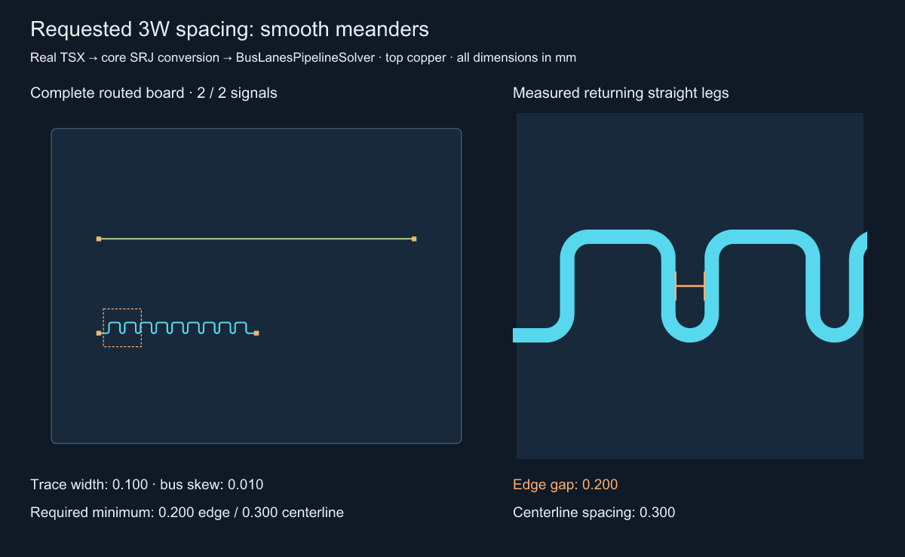

# Smooth return-leg spacing reproduction

Run `bun install`, then
`bun test tests/meander-return-gap.test.ts tests/min-meander-gap.test.ts`.
Generate the corrected images with
`bun scripts/repro-meander-return-gap.ts three-widths`,
`bun scripts/repro-meander-return-gap.ts wide`, and
`bun scripts/repro-meander-return-gap.ts paired`.
The preserved before image comes from the reproduction commit `18c72ec`;
run its original script on that revision to regenerate it.

The source is `tests/fixtures/meander-return-gap.tsx`: four real SMT pads,
two traces, and one length-matched bus. Core renders that TSX and converts it
to SRJ, including the bus declaration. The public `BusLanesPipelineSolver`
routes it from scratch; no Circuit JSON or saved routes are authored by hand.
The generator refuses an unfinished solver or an unmatched bus.

Review the orange dimension in the magnified panel. Two opposite returning
straight legs measure **0.240 mm center-to-center**, hence **0.140 mm edge gap**
with a 0.100 mm trace. The documented three-width centerline floor would require
0.300 mm center-to-center / 0.200 mm edge-to-edge. Pad clearance is a separate
constraint. Both signals are complete and their bus skew is 0.010 mm.

The ordinary tests prove the fixture solves, preserves legacy spacing when the
option is omitted, and meets 3W when `minMeanderGap: 0.2` is supplied. The
reproduction commit marked the old blanket 3W assertion `test.failing`; the fix
corrects that documentation and tests the explicit request without that marker.
`measure-return-gap.ts` independently measures overlapping antiparallel long
segments, excluding sampled arc chords; it does not call the solver's spacing
predicate. `before.json` records the measured points and complete bus report.

## After: explicitly requested spacing

| Case | Measured edge gap | Centerline spacing | Bus skew |
| --- | ---: | ---: | ---: |
| Before / unchanged default | 0.140 mm | 0.240 mm | 0.010 mm |
| `minMeanderGap: 0.2` (3W) | 0.200 mm | 0.300 mm | 0.010 mm |
| `minMeanderGap: 0.5` | 0.500 mm | 0.600 mm | 0.010 mm |
| Shared pair, `minMeanderGap: 0.5` | 0.516 mm | 0.616 mm | 0.010 mm |

Review the orange dimension between arms of the **same trace**. On the paired
image, the two colors are distinct nets; their own 0.120 mm rail gap remains
independent of the requested return gap. Each image is a completed fresh solve.
The generator now gates output on native copper DRC as well as solver success,
bus matching and the independently measured return gap. JSON files beside each
image record measurements. Native DRC, bus/pair skew, shared coupling, input
immutability, a rotated wider trace, invalid values and an infeasible gap are
also covered in `tests/min-meander-gap.test.ts`.

The existing octilinear tuner cannot lengthen this paired fixture while keeping
its shared corridor; that case still fails explicitly rather than returning a
successful but uncoupled/underspaced route. Smooth shared-pair tuning succeeds.

## Benchmark effect

The reproduction changes no solver implementation or AM3352 fixtures. The fix
preserves legacy behavior when the option is absent: octilinear tuning defaults
to a 2W edge gap, while smooth tuning retains its electrical clearance floor.
The public AM3352 inputs remain unchanged. No electrical, timing, coupling or
connectivity check is lowered.

An explicit value applies during smooth, octilinear, packed/folded and paired
tuning and at final output acceptance. A pocket that only fits the legacy
0.140 mm returns can fail when 0.200 mm is requested. The confined-pocket test
checks that failure and a successful wider pocket. Small corrections may use
a shallow curve or a single lobe at the existing radius if its returning arms
already satisfy the requested gap; repeated cells use a larger radius when
necessary. Small real-TSX cases also pass copper DRC and bus/pair matching.

Fresh base/head AM3352 runs remain required by `AGENTS.md`. Each PR's Blacksmith
matrix runs all 11 samples with 3,600 seconds per solver/sample and retains the
raw comparison. Pending or incomplete checks do not establish merge readiness.
