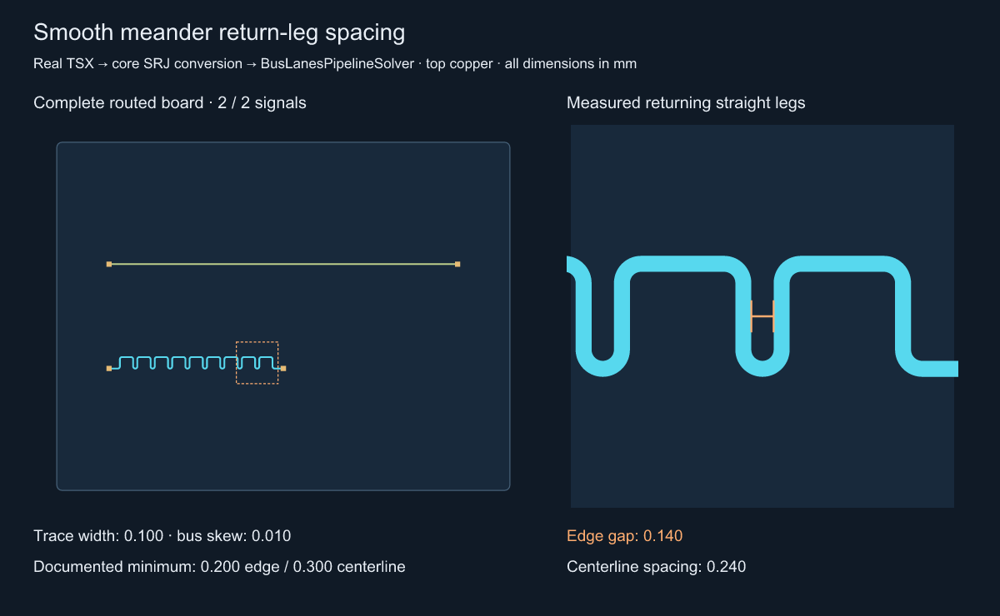
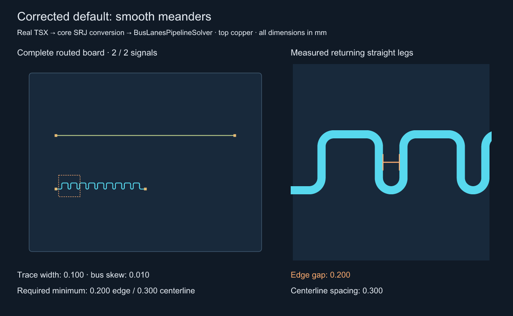
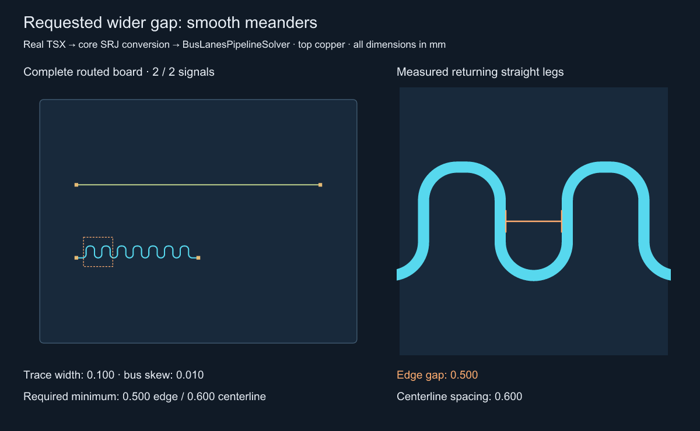
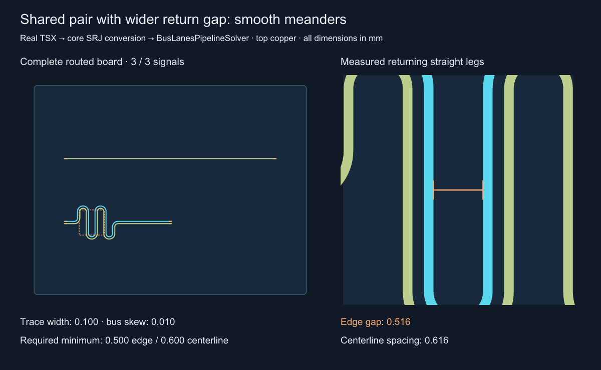

# Smooth return-leg spacing reproduction

Run `bun install`, then
`bun test tests/meander-return-gap.test.ts tests/min-meander-gap.test.ts`.
Generate the corrected images with
`bun scripts/repro-meander-return-gap.ts default`,
`bun scripts/repro-meander-return-gap.ts wide`, and
`bun scripts/repro-meander-return-gap.ts paired`.
The preserved before image comes from the reproduction commit `18c72ec`;
run its original script on that revision to regenerate it.

The source is `tests/fixtures/meander-return-gap.tsx`: four real SMT pads,
two traces, and one length-matched bus. Core renders that TSX and converts it
to SRJ, including the bus declaration. The public `BusLanesPipelineSolver`
routes it from scratch; no Circuit JSON or saved routes are authored by hand.
The generator refuses an unfinished solver or an unmatched bus.

Review the orange dimension in the magnified panel. Two opposite returning
straight legs measure **0.240 mm center-to-center**, hence **0.140 mm edge gap**
with a 0.100 mm trace. The documented three-width centerline floor would require
0.300 mm center-to-center / 0.200 mm edge-to-edge. Pad clearance is a separate
constraint. Both signals are complete and their bus skew is 0.010 mm.

The ordinary tests prove the fixture solves and meets the documented spacing.
The reproduction commit marked only the spacing assertion `test.failing`;
the fix removes that marker.
`measure-return-gap.ts` independently measures overlapping antiparallel long
segments, excluding sampled arc chords; it does not call the solver's spacing
predicate. `before.json` records the measured points and complete bus report.

## After: default and requested spacing

| Case | Measured edge gap | Centerline spacing | Bus skew |
| --- | ---: | ---: | ---: |
| Before | 0.140 mm | 0.240 mm | 0.010 mm |
| Corrected default | 0.200 mm | 0.300 mm | 0.010 mm |
| `minMeanderGap: 0.5` | 0.500 mm | 0.600 mm | 0.010 mm |
| Shared pair, `minMeanderGap: 0.5` | 0.516 mm | 0.616 mm | 0.010 mm |

Review the orange dimension between arms of the **same trace**. On the paired
image, the two colors are distinct nets; their own 0.120 mm rail gap remains
independent of the requested return gap. Each image is a completed fresh solve.
The generator now gates output on native copper DRC as well as solver success,
bus matching and the independently measured return gap. JSON files beside each
image record measurements. Native DRC, bus/pair skew, shared coupling, input
immutability, a rotated wider trace, invalid values and an infeasible gap are
also covered in `tests/min-meander-gap.test.ts`.

The existing octilinear tuner cannot lengthen this paired fixture while keeping
its shared corridor; that case still fails explicitly rather than returning a
successful but uncoupled/underspaced route. Smooth shared-pair tuning succeeds.

## Benchmark effect

The reproduction changes no solver implementation or AM3352 fixtures. The
stacked fix tightens the smooth tuner's formerly inconsistent default, so its
routing geometry and search behavior can change. A pocket that only fits the
old 0.140 mm returns may now fail; the confined-pocket regression checks that
failure and a successful wider pocket without lowering any clearance or timing
check. The packed-bank height comparison permits 25% rather than 30% savings
while strengthening its self-spacing assertion from 0.200 to 0.300 mm.

Fresh base/head AM3352 runs remain required by `AGENTS.md`. Each PR's Blacksmith
matrix runs all 11 samples with 3,600 seconds per solver/sample and retains the
raw comparison. Pending or incomplete checks do not establish merge readiness.
