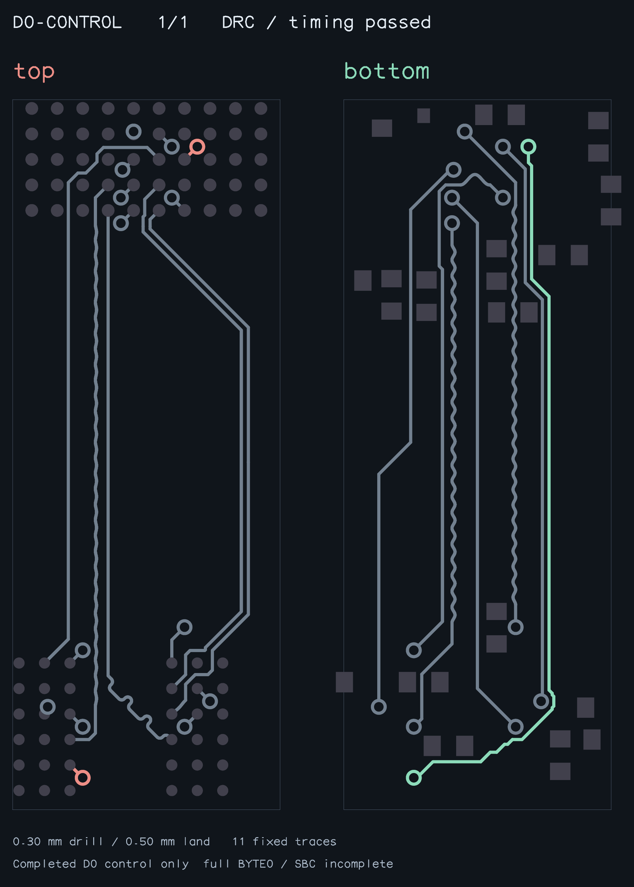
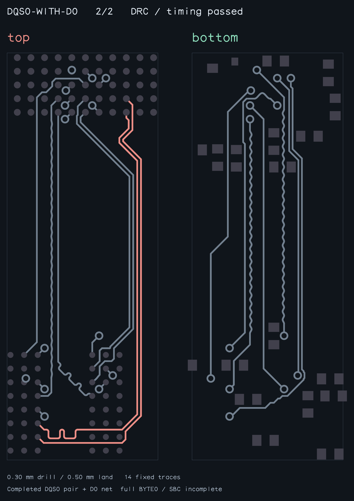

# Native counterfactual selection reproduction

`bun test tests/native-counterfactual-choice.test.ts` freshly solves BYTE1 from the existing public native fixture, then computes D0 with the pair released. The one-signal compatibility pool reverses four candidates and replaces the shortest candidate with its last candidate: TOP, 24.405 mm. DQM0 then has no escape domain (24 yields). Three BOTTOM alternatives are shorter (23.243–24.043 mm) and let the existing bounded router complete DQM0 (33 yields each).

This establishes individual reachability, not a joint BYTE0 or SBC solve. The input is unchanged. Coordinates are board-world XY mm, +X right/+Y up. All fixed BYTE1 copper is freshly solved; no saved route or manually authored route is loaded. Via drill/land dimensions remain 0.30/0.50 mm.

`bun scripts/snapshot-native-counterfactual.ts` freshly computes and independently validates the completed **D0 net only** below, around freshly solved BYTE1 (grey). The exporter refuses output unless native pad connectivity through all owned dogbones, native DRC, absolute D0 length and scoped length matching pass. It separately checks prior BYTE1 bus length, pair skew and physical coupling. Full BYTE0 matching is not established by this scoped control. Failed DQM0 diagnostic captures are never exported.

The eventual repair must consider ordinary seed copper when detecting duplicate states: a compatible new ordinary prefix is progress even if the pair is unchanged. Simply selecting the shortest candidate while retaining a pair-only duplicate key discards these alternatives. Any replacement must still check pair geometry and future escape access, keep fixed input copper immutable, bound child work and pass the full legacy benchmark.

Benchmark effect: tests and validation only; production solver unchanged. Every PR must have a fresh paired Blacksmith 11/11 comparison, reported before readiness.

## Counterfactual repair fix

Native repairs now collect the solver's existing computed ordinary alternatives, try shorter alternatives first, and check peer escape access before starting an expensive pair search. A peer's empty domain rejects that reservation; an inconclusive bounded probe retains it. Prior ordinary prefix copper is preserved while planning the next signal. No pair or ordinary geometry is authored manually.

Repeat detection includes the pair, ordinary prefix and owned escapes, ignoring trace IDs/order. A newly compatible ordinary prefix is progress even when the pair is unchanged. Every computed ordinary reservation is first tried with the existing fully native pair. Reuse rechecks endpoints, allowed layers, absolute length, pair skew/coupling, new-copper DRC and fixed-copper clearance. Via lands must cover the declared drill clearance; unsupported or incomplete manufacturing data retain the original pair-search fallback. Previously seen complete states are skipped before this reuse check. Pair movement remains available after the existing pair has been tried against all computed reservations. The parent still limits pair-repair iterations; all pair, absolute-length and physical acceptance remain required.

`bun scripts/snapshot-native-counterfactual-repair.ts` freshly computes the native prefix and pair, then independently validates their connectivity, combined native DRC, absolute lengths, scoped D0 matching, DQS0 skew/coupling, prior BYTE1 matching and input immutability. Its completed snapshot is below. Full BYTE0 matching and SBC completion remain unproven.

The repair uses 3,836 yields and keeps the valid pair unchanged while adding a BOTTOM D0 prefix with no peer empty domain found. This is a deterministic work-count result for this scoped case; the full legacy paired benchmark is reported separately. Existing repair coverage now requires a new complete repair state (pair/prefix/escapes), not mandatory pair movement, plus a bounded yield count and peer-domain check. Input immutability, combined DRC and pair validation remain enforced.

Risk: bounded peer probes do not prove joint routability. Retained ambiguous candidates and the existing bounded parent search/final acceptance prevent treating a reachability heuristic as a completed byte.

When the first reservation is excluded, the native regression finds a distinct valid prefix in 3,785 yields, rather than re-enumerating pair geometry first. It independently checks both completed states against the full prior-byte connection context, and rejects native-pair reuse for displaced endpoints or stricter unsupported drill clearances. The scoped D0 audit counts its carrier plus both escapes (24.373951 mm total).
