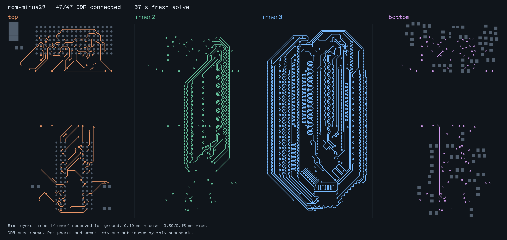

# Default native DDR group routing

The normal `new BusLanesPipelineSolver(input)` now completes all 47 requested
DDR connections on the populated six-layer `ram-minus29` regression. Upstream
exhausts its routing plans on the identical input. This is a production solver
path, not a script that individually routes buses or supplies clock centerlines.

This benchmark routes **DDR only**. The 221 components and 135 capacitors,
including USB and power components, remain physical obstacles, but peripheral
and power nets are not routing requests. Whole-SBC completion is not established.

## Mechanism

- Reserve escape sites for every requested signal before routing a timing group.
  Keep earlier completed groups fixed while searching subsequent groups.
- When a clear path cannot fit its required tuning length, penalize that corridor
  so a retry explores another topology.
- Derive paired-corridor alternatives from package geometry and try permitted
  inner layers. Preserve original package fields when checking exterior coupling;
  reservation vias must not enlarge the allowed uncoupled region.
- Reject same-net via holes inside pads by default. Preserve absolute length
  ceilings during pair planning and validate the complete result before success.
- Bound group alternatives and default this strategy to a 300,000 ms elapsed
  budget. `maxRoutingTimeMs` overrides it. This deadline is checked between solver
  steps, not a hard preemption of synchronous work. Failure is explicit and
  `getOutput()` rejects incomplete copper. Completed groups are retained in memory
  during retries, not persisted as resumable checkpoints.

Eligibility is deliberately limited: fresh top-side endpoints, no fixed input
routes, disjoint timing groups with one differential pair each and finite length
bounds, two or more allowed inner layers, and axis-aligned package centers.
Other inputs keep the existing solver path. No capacitor is moved automatically.

## Fresh base/head evidence

| Layout | Upstream | Production change |
| --- | --- | --- |
| RAM (0, -29) mm | Failed after 81.160 s, `no_planar_route` | **47/47, 136.981 s routing; 163.288 s including independent audit** |
| RAM (0, -25) mm | Comparison pending | Earlier attempt failed; final comparison pending |

The first comparison establishes completion where upstream fails, not a speedup
between two successful runs. Both runs start without routes, use identical input
hashes and a 300-second budget. Input bytes remain unchanged. The second layout
is included to expose the remaining placement sensitivity, not counted as a pass.

For the accepted route:

- Exact native endpoint coordinates/layers: 47/47.
- Routed-copper DRC: passed (56,676 segments, 94 through vias).
- Byte0 / byte1 / address-control total copper skew: 0.635 / 0.635 / 0.635 mm.
- Corresponding pair skew: 0.127 / 0.032896 / 0.101899 mm; limit 0.127 mm.
- All absolute length bounds and exterior coupling checks pass.
- All 11 native PCB checks return zero findings, using the original circuit's
  connectivity map. The raw report lists each check and each trace length.



This is geometric/timing validation, not stackup-qualified impedance, signal
integrity simulation, or hardware qualification. See the fixture README for
length-bound construction and capture provenance.

## Reproduce

Production routing revision: `97f804169f102c39a0c662259c1eb3241f76616c`.
Base: `992e0448aee2c40b0d8fa1d3f0537f364b0e60cc` (v0.0.35).
Subsequent report/export changes do not change `lib/`.
Environment: Linux x86_64, AMD EPYC 9V74, Bun 1.4.0. Runs were sequential on the
same machine. Both checkouts used the same installed dependency tree. Independent
native checking used `@tscircuit/checks` 0.0.264 via `NATIVE_CHECKS_MODULE`; this
version is now declared in package.json. No timing result is imported from an
older saved route.

```sh
bun scripts/benchmark-native-groups.ts --sample ram-minus29 \
  --solver /path/to/base/lib/index.ts --timeout-seconds 300 --output .cache/base-b
bun scripts/benchmark-native-groups.ts --sample ram-minus29 \
  --solver /path/to/head/lib/index.ts --timeout-seconds 300 --output .cache/head-b
bun scripts/snapshot-native-groups.ts .cache/head-b .cache/head-b-completed.png
```

The exporter independently revalidates the saved result before emitting a PNG;
export revalidation is not counted as a fresh solve. Gzipped accepted routes,
raw reports and the inspected snapshot are retained here. Failed cases have no
routing snapshot or accepted route artifact.

The mandatory existing 11-sample Blacksmith comparison uses a separate 3,600 s
budget per solver/sample and remains required before merge. Its results must be
reported separately: the new 47-net regression does not replace that suite.
