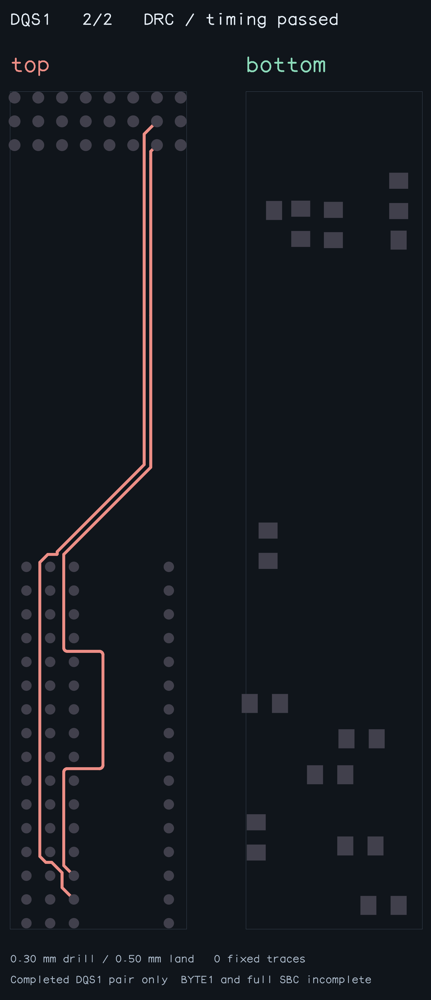
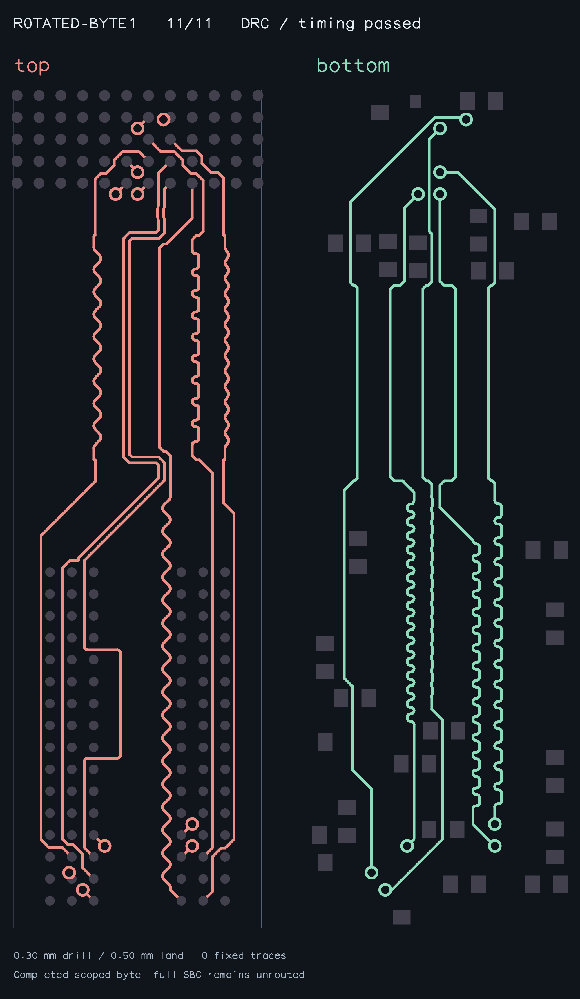

# Native first-phase pair seed reproduction

`bun test tests/native-first-phase-seed.test.ts` reproduces the skipped first-phase native seed. The unmodified helper returns immediately with no prior copper, while the existing coupled router freshly completes DQS1 on the same native endpoints in 283 yields. The input contains all physical board obstacles and unchanged derived DDR limits, with 0.30 mm drill / 0.50 mm land vias.

`bun scripts/snapshot-native-first-phase.ts` freshly solves and independently checks the scoped pair before writing its image. Checks cover endpoints/layers, native copper DRC, absolute lengths, pair skew/coupling and input immutability. This is a completed **2/2 DQS1 control only**, not a routed byte or SBC. The gzipped fixture contains no saved copper. Coordinates are board-world XY mm, +X right/+Y up; provenance accompanies the input.

Naively removing the eligibility guard changes the original first-byte route and breaks the existing sequential pair-repair regression. A fix must preserve the successful preferred path and introduce first-phase native seeds as bounded alternatives, retaining fallback search.

Benchmark effect: reproduction/validation only; production solver unchanged. Fresh paired all-11 Blacksmith measurements are required and will be reported in the PR before readiness.

## Bounded alternative

The first-phase search keeps the existing strategy for 35,000 yields, then cancels it before trying a native seed for at most 100,000 yields. If neither completes, it restarts the original unrestricted search. Prior-copper routing and the helper's default eligibility are unchanged. Only a hard-length bus with exactly one pair on a common allowed native layer participates.

`bun test tests/native-first-phase-byte.test.ts` freshly solves the rotated input end to end and audits endpoints, full-byte DRC, absolute and relative bus lengths, pair skew/coupling, and input immutability. `bun scripts/snapshot-native-first-phase-byte.ts` independently gates the complete 11/11 byte snapshot below. This is not a routed SBC.

The complete native case takes 65,096 pipeline steps, including the preferred-search lead. The previous naive guard removal is deliberately not used: it changed the original first-byte copper and broke the downstream pair-repair control. Existing native pair and repair regressions must pass alongside the legacy 11-case benchmark.

Risk: for an eligible first phase where neither bounded search completes, the original strategy restarts after up to 135,000 extra yields. Ineligible and prior-copper cases keep their original search order. No placement, timing, via or clearance constraints are relaxed.
