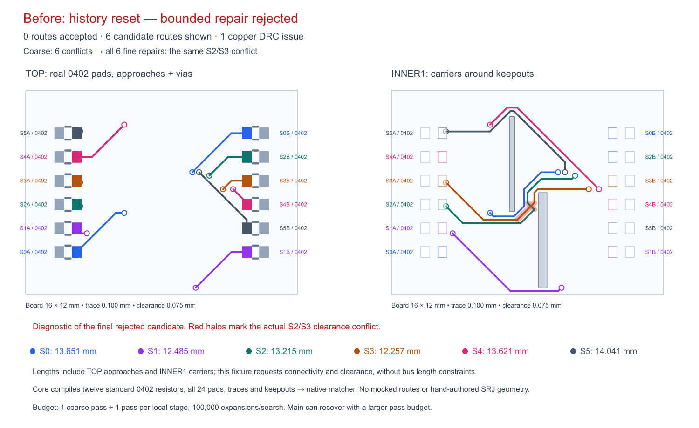

# Native matching congestion handoff

The [TSX circuit](../../../tests/fixtures/native-matching-history.tsx) declares a 16 × 12 mm, four-layer board with twelve standard 0402 resistors (all 24 actual rectangular SMT pads), six crossing signals and two inner1 keepouts. Published Core 0.0.2125 compiles its Circuit JSON and routing input. The only adaptation is declaring inner1 as the native matcher's carrier layer; pad coordinates, ownership, every unused pad obstacle, keepouts, connections and board bounds come from Core.

The resistor rows use 1.4 mm spacing to avoid real 0402 courtyard overlap. Left pin2 and right pin1 are the signal terminals; the other twelve pads remain physical obstacles. The test checks every compiled 0.54 × 0.64 mm pad against its unmodified routing obstacle and derives signal endpoints from their actual port positions. Trace width is 0.10 mm, copper clearance 0.075 mm and through-via diameter 0.30 mm / 0.15 mm drill. The authored INNER1 keepouts are 5.6 mm tall; routing uses 0.60 mm coarse and 0.20 mm fine grids.

Run `bun test tests/native-matching-history-crossing.test.tsx` for the end-to-end routing regression, or `bun scripts/snapshot-native-matching-history.ts` to regenerate the labeled SVG, PNG and numeric report for the current implementation. The regression compares its actual result's generated SVG and numeric report with the committed artifacts, preventing stale labels, geometry or measurements.

The fixture uses a supported bounded configuration: one coarse pass, one pass in each local repair stage, and 100,000 search expansions per route. It provides no saved routes, mocks or manually constructed obstacles. On main, the coarse stage has six physical conflicts. The first fine stage reduces these to one S2/S3 copper clearance conflict, and each of the remaining five fine repair stages repeats that conflict and the matcher returns `null`. The before panel shows the **final rejected candidate**, whose endpoints are connected but whose copper fails real DRC. It is a diagnostic, not a successfully routed board.

Preserving history lets the first fine stage remove all six coarse conflicts. All six accepted traces connect their compiled endpoints; their twelve full-span plated vias and route copper pass the native DRC validator. The after panel is generated only after these checks pass. Colors identify S0–S5 on both layer panels, endpoint labels identify A/B resistor terminals, colored rectangles show the selected real pads, pale gray rectangles show the actual unused pads, and larger gray rectangles are the compiled keepouts. Red halos identify the actual conflicting copper. Lengths include both TOP approaches and inner1 carriers. No bus length constraints are requested in this connectivity/clearance fixture.

This demonstrates a failed bounded repair and repeated conflict after each history reset. This fixture intentionally bounds each repair stage to one pass; it is not evidence that the default matching settings inevitably fail. The original AM3352 board and the separate eleven-sample benchmark remain independent validation work.

Core's published package imports several runtime packages without declaring them as dependencies. The pinned development dependencies supply those imports and align Circuit JSON with Core's schema. The existing fanout solver stays pinned to its original algorithm version. A behavior-neutral `ReturnType<typeof routeAlternateSignalDogbones>` annotation makes `initialSignalDogbones` declarations portable when Core introduces another autorouter version; no routing logic changes in the reproduction.

