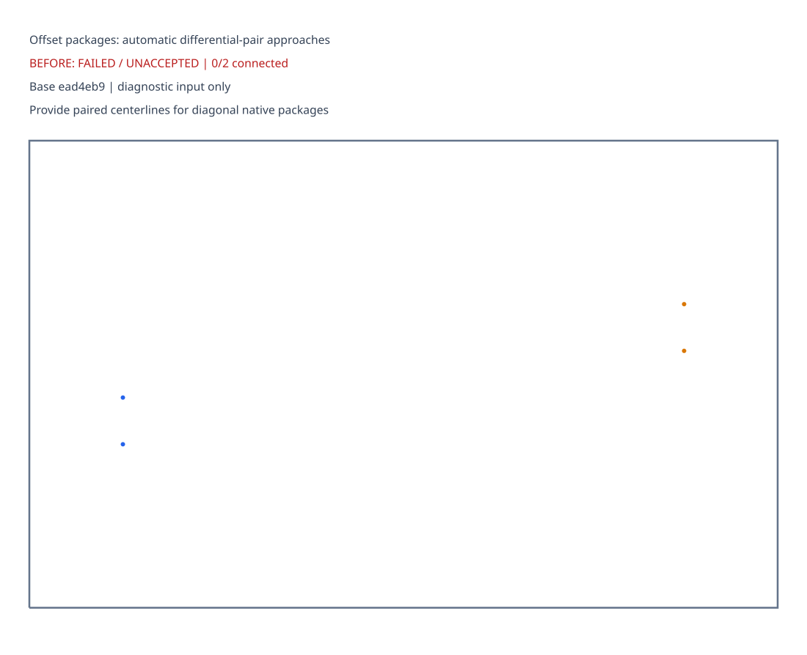
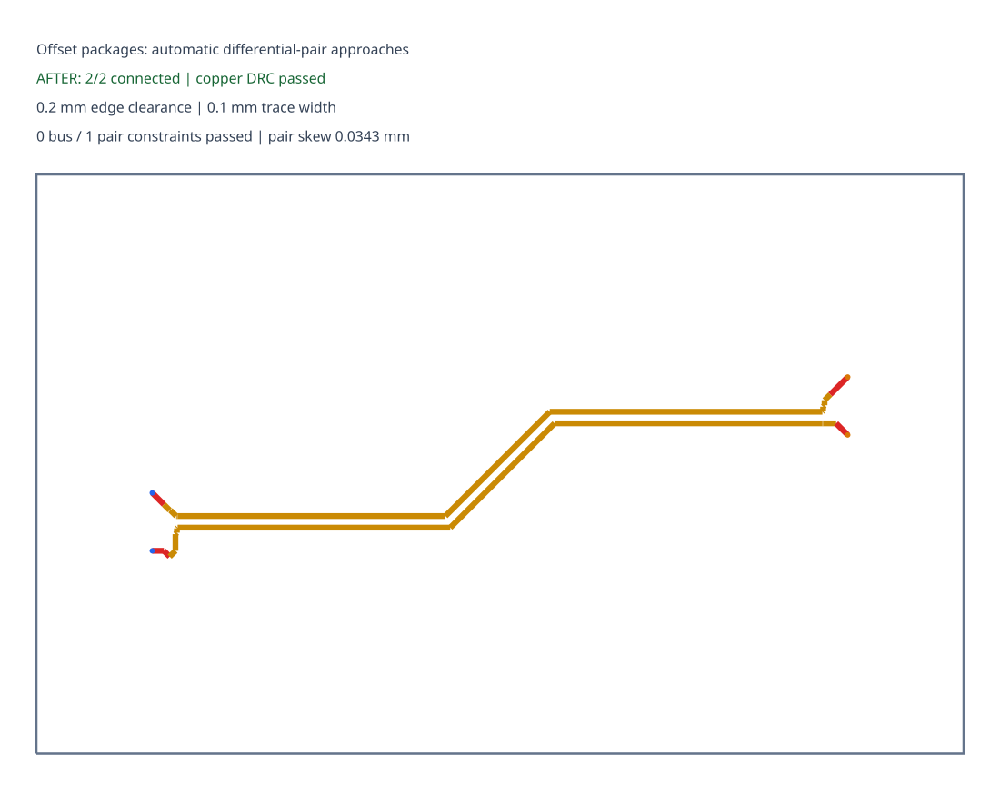

# offset-pair regression: before and after

| Before: pinned main rejected this input | After: fresh accepted routing |
| --- | --- |
|  |  |

The before diagnostic was explicitly requested for this comparison. It records the failure from `ead4eb9db255118af9713136abb16e4d72e5c36c`, with zero accepted connections and no partial search copper. The after snapshot contains only final copper from a fresh solve that passed original-endpoint connectivity, copper DRC, and applicable bus/pair matching and coupling checks. Both panels use the same input and board scale.

Rendering uses the existing `BusLanesSolver.visualize()` and `graphics-debug` `getSvgFromGraphicsObject()` helper. No handwritten SVG geometry is used. The test compares the regenerated SVG with the committed after snapshot. Both panels were visually inspected; [validation and pinned revision provenance](validation.json) are retained.

Regenerate the after snapshot after its checks pass:

```sh
BUN_UPDATE_SNAPSHOTS=1 bun test tests/offset-native-pair.test.ts
```

These focused synthetic cases demonstrate each fix independently; full AM3352 fresh-solve acceptance is a separate CI check.
