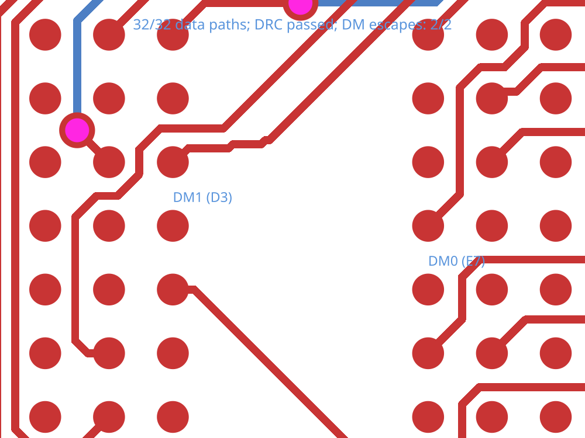

# A13 data routing and pending RAM mask pads

The native A13 bus phases route 32 data paths before the remaining address, control and strobe signals. On bus-lanes-solver 0.0.65 the completed data lanes leave RAM DM0 (E7) accessible and close the escape beside DM1 (D3). The updated solver preserves an escape to the bottom signal layer for both pads.



The test freshly routes both RAM bytes after the 16 supplied CPU-side data paths. It checks all 32 paths, DRC, supplied-copper preservation and access to both mask pads before rendering the SVG. The remaining 64 nets are routed by a separate phase in the full board.

```sh
bun test tests/a13-pending-mask-access.test.ts --timeout 900000
bun repros/a13-pending-mask-access/capture.tsx /path/to/core
```

The existing fixture was captured with Core 0.0.2396 and bus-lanes-solver 0.0.58. Its RAM byte inputs have the same pads, placement, constraints and 16 incoming CPU trace geometries as the full run on tscircuit 0.0.3280. The capture command runs all four bus phases from the original TSX. [Native board source](https://github.com/ShiboSoftwareDev/core-ddr-benchmark/tree/24dc44c166d4258c3538f8b1f66953f1b6f58690/circuits) · [Original capture](https://github.com/tscircuit/core/actions/runs/43921005346)
