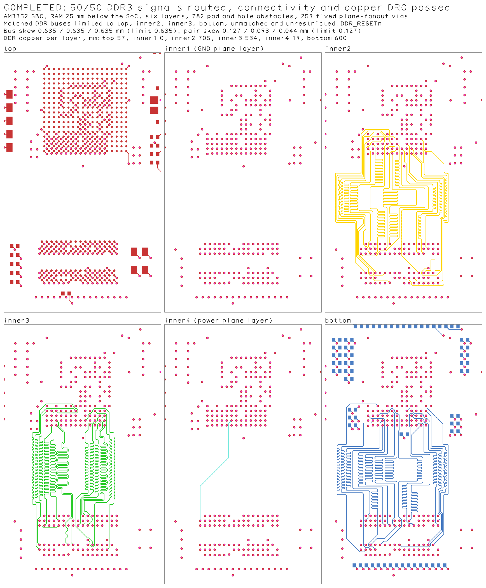
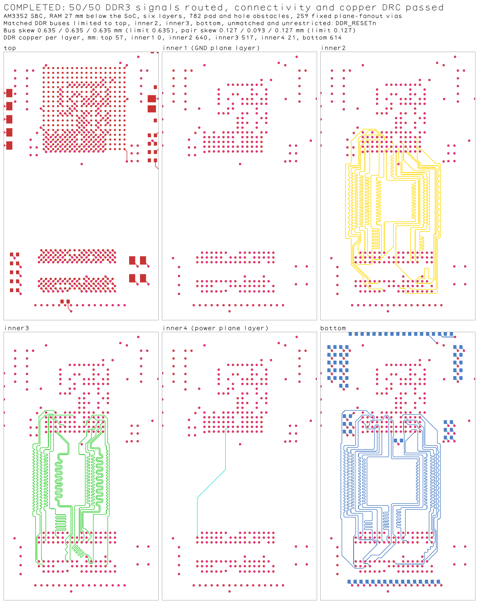
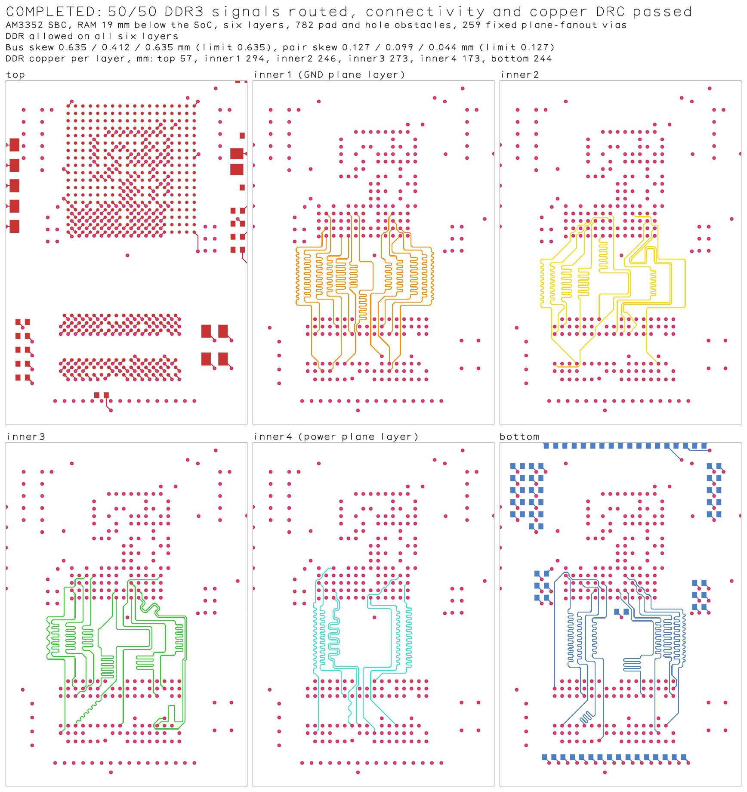
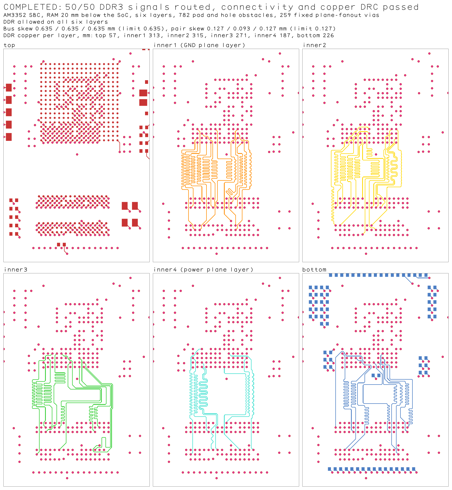

# AM3352 + DDR3 SBC, DDR3 phase on the full board

A six-layer single-board computer written from scratch in tscircuit TSX
([lib/sbc.tsx](lib/sbc.tsx)): AM3352 ZCZ (324 balls), MT41K256M16 DDR3L (96
balls), TPS65217C PMIC, microSD, USB-C, crystal, boot straps, headers and
decoupling, 132 components on a 72 mm wide board. Stack: top, inner1 (GND
pour), inner2, inner3, inner4 (VDD_DDR and 3.3 V pours), bottom. It is a
routing exercise, not a manufactured design, and no impedance or stackup
claims are made.

Routing runs in phases. Plane fanout for the SoC, the RAM and the remaining
parts comes first and leaves 259 fixed through vias. The DDR3 phase follows: 50
point-to-point signals, with two data byte buses and one address/control bus
matched to 0.635 mm, and the DQS0, DQS1 and CK pairs matched to 0.127 mm with a
0.1 mm gap at 0.1 mm clearance. Each capture here is the exact Core input of
that DDR3 phase, with all 782 pad and hole obstacles and the 259 fanouts as
supplied copper.

| Capture | TSX | RAM below SoC | DDR layers | `main` (`64ec508`) | Balanced pair lobes at the clearance limit | Demand-sized tuning banks | Banks fitted to the board |
| --- | --- | ---: | --- | --- | --- | --- | --- |
| `20mm` | [board-20mm.tsx](board-20mm.tsx) | 20 mm | all six | fails: `No shared tuning corridor for DDR_DQS0, DDR_DQSn0` | 50/50 routed and matched | 50/50, different copper | 50/50, unchanged |
| `19mm` | [board-19mm.tsx](board-19mm.tsx) | 19 mm | all six | fails, same error | fails, same error | 50/50 routed and matched | 50/50 on an earlier layer attempt, different copper |
| `27mm-off-planes` | [board-27mm-off-planes.tsx](board-27mm-off-planes.tsx) | 27 mm | matched buses on top, inner2, inner3, bottom | not run on Linux x64 | fails: `Coupled tuning candidate budget exhausted` | 50/50 routed and matched | ROW27 |
| `25mm-off-planes` | [board-25mm-off-planes.tsx](board-25mm-off-planes.tsx) | 25 mm | matched buses on top, inner2, inner3, bottom | not run on Linux x64 | not run on Linux x64 | fails: `Coupled tuning candidate budget exhausted` | 50/50 routed and matched |

Published `tscircuit@0.0.3131` / Core `0.0.2315` / bus-lanes-solver `0.0.50`
fails all four through `tsci build`.

## 25 mm, matched buses off both plane layers



Two things on this board defeated the tuning banks at 25 mm. Several lanes
step 0.05 mm sideways past a RAM fanout via, and the returning-arm test read
that kink as a hairpin, which rejected every bank layout, every meander and
finally the finished route on those lanes. And other parts' vias and pads sit
inside the tuning window just below the SoC, where the banks start.

## 27 mm, matched buses off both plane layers



The three matched buses carry `pcbAllowedLayers` of top, inner2, inner3 and
bottom. The ground plane layer carries no DDR copper. The one trace on inner4
is DDR_RESETn, which is in no bus and therefore not restricted.

## 19 mm, all six layers



## 20 mm, all six layers



With all six layers allowed the solver puts about 40% of the DDR copper on
the two plane layers (inner1 and inner4 in the images). That is the released
behaviour and is not changed here.

```sh
bun test tests/am3352-ddr3-sbc-20mm.test.ts tests/am3352-ddr3-sbc-19mm.test.ts \
  tests/am3352-ddr3-sbc-27mm-off-planes.test.ts \
  tests/am3352-ddr3-sbc-25mm-off-planes.test.ts
bun repros/am3352-ddr3-sbc/render-png.ts 20mm 19mm 27mm-off-planes 25mm-off-planes
# Run a TSX through the published Core stack and dump the phase inputs:
bunx tscircuit build --disable-parts-engine --autorouter-dump-srj all \
  --autorouter-debug-dir /tmp/am3352-ddr3-sbc repros/am3352-ddr3-sbc/board-19mm.tsx
```

On Linux x64 the 20 mm and 19 mm solves take about 2 to 3 minutes each, the
25 mm solve about 5 minutes and the 27 mm solve about 11 minutes.

Not covered: with the matched buses off the plane layers, 24 mm also routes
with the fitted banks (10 to 14 minutes on Linux x64, not a test), and 20 to
23 mm still fail on every revision. There the DQS and CK pairs find no room
for their meander. In the 21 mm state inspected, the tuning window between
the SoC pad field and the RAM escape vias was 7 mm long before the vias below
the SoC are taken out.

Each image is a PNG render of a test-owned snapshot in
[tests/__snapshots__](../../tests/__snapshots__). A failed solve records native
pads and the supplied fanout copper under a FAILED BASELINE caption, with no
candidate copper. DDR copper is drawn only after connectivity, copper DRC
against all 259 fanouts, bus matching, pair matching and pair spacing pass.

The lane search takes a different path on macOS arm64 than on Linux x64 and
produces different, also valid, copper. The snapshots are therefore compared on
Linux x64 (the CI platform) only; every acceptance check runs on all platforms.

Each `provenance.json` beside a capture records the tool versions, the capture
command and the input hash. Footprints in [imports/](imports) were generated
by `tsci import` from the JLCPCB parts C91145, C253882, C116081, C70590,
C468247, C165948 and C318884.
