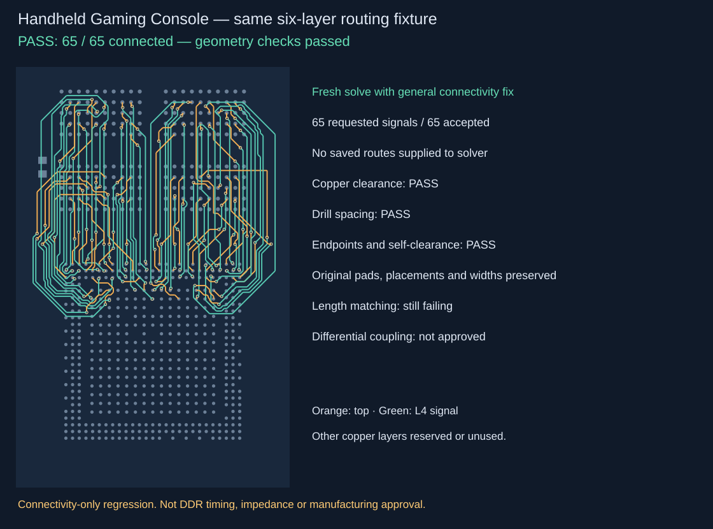
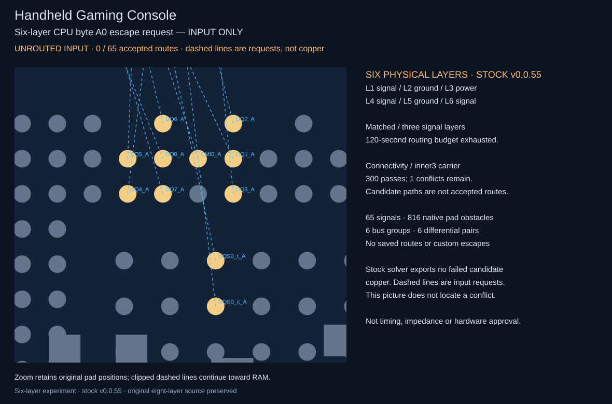

# Handheld Gaming Console — six-layer CPU/RAM reproduction



[CPU escape snapshot](cpu-escape.snap.svg) · [Immutable SRJ](../../tests/fixtures/handheld-gaming-console/input.srj.json) · [Recorded baseline](baseline.json) · [Source provenance](provenance.json)

This six-layer experiment reproduces the RK3562 / Rayson RS512M32LO4D1BDS-53BT routing failure using the unmodified bus-lanes solver. It requests all 65 memory signals from the saved R269 handheld board, retaining the placements and 816 pad obstacles. No saved routes are replayed and no custom escape or repair code is injected.

## Run

From the repository root, with Bun installed:

```sh
bun install --frozen-lockfile --ignore-scripts
bun test ./tests/handheld-gaming-console-fixture.test.ts
bun repros/handheld-gaming-console/run.ts matched
bun repros/handheld-gaming-console/run.ts connectivity
bun repros/handheld-gaming-console/snapshot.ts
```

Each routing command runs independently. Exit code **2** means failure or budget exhaustion; it is expected on the recorded baseline. Exit code 0 only means the solver reports success and returns every requested signal. It does not mean electrical or manufacturing approval. The fixture test verifies source integrity and endpoint conversion, not routing success.

The runner uses this checkout's `lib` directly. Run the same commands on a future fix branch with unchanged fixture hashes. Reports include the checkout revision, solver version, effective input hash, options, runtime, errors, returned route count and planar matching reports. Each run gets a 120-second cooperative budget; an external process timeout can be added when testing solver changes.

## Two distinct cases

- **Matched:** six physical layers, three allowed signal layers (`top`, `inner3`, `bottom`), 65 signals, six bus groups and six differential pairs. Requested group spread is 0.5 mm, pair skew 0.1 mm and pair gap 0.25 mm. The inherited 35 mm group maximum is an experimental routing cap, not a verified RK3562 limit.
- **Connectivity:** same pad geometry, but one inner carrier (`inner3`), 0.1 mm search grid, up to 300 negotiation passes and 300,000 expansions per route. This solver uses the 0.09 mm pad clearance as its conflict clearance. It does **not** enforce the matched case's timing, pair coupling or stronger signal-integrity spacing requirements.

The proposed layer plan is **L1 signal / L2 ground / L3 power / L4 signal / L5 ground / L6 signal**. Ground and power layers are reserved from signal routing; plane copper and dielectric thicknesses are not modeled or qualified here.

Both use 0.09 mm traces and nominal 0.25/0.15 mm via land/drill settings. These are reproduction inputs, not fabrication approval.

## Recorded baseline

Version **0.0.55**, checkout `b13b6399e727dd7f73350341cae609d6f95fbe1e`, with the six-layer fixture changes:

- Matched routing exhausts the 120-second cooperative budget in `route_shared_layers` and returns zero accepted traces.
- Connectivity negotiation reaches candidates for all 65 signals but retains one conflict after 300 passes. It fails with `Single-layer negotiation exhausted its pass budget` and returns zero accepted traces.

Candidate counts in solver statistics must not be described as completed routing. No internal candidate geometry or diagnostic solver modifications are included in this repro. The fixture is not weakened to turn the failure into a pass.

`results/` contains ignored, locally generated reports; `baseline.json` retains the compact measured failure evidence. The two tracked snapshots show original pad geometry and dashed **unrouted requests**, never internal candidate copper. The exporter refuses supplied traces and a baseline with accepted output. Deterministic snapshot tests compare the committed SVGs and enforce these labels and guards. The connectivity conflict location is not exported by the stock solver, so neither image claims to locate it.



This structure follows Seve's [MT8395 repro PR #134](https://github.com/tscircuit/bus-lanes-solver/pull/134): immutable fixtures under `tests/fixtures`, replay tooling, measured baseline, input snapshots, and separate source-integrity/visualization checks. Unlike that core capture, this input is extracted from native KiCad pads; it is not represented as an exact core-emitted request. A future successful result requires independent connectivity, copper DRC, group/pair matching and coupling checks before replacing these input diagnostics with completed copper.

## Source and scope

`source/board.kicad_pcb.gz` preserves the original **eight-layer** R269 board unchanged. The active six-layer fixture is a derived routing experiment, not a converted or electrically approved native PCB. [The eight-layer input](../../tests/fixtures/handheld-gaming-console/eight-layer.input.srj.json) and [its measured baseline](source/eight-layer-baseline.json) remain available. Only `layerCount` and global `allowedLayers` change between the two inputs; a regression test verifies that all other geometry and constraints remain identical. `../../tests/fixtures/handheld-gaming-console/pads.json` captures its pad geometry; `provenance.json` records immutable hashes. Coordinates convert as `x = native_x - 100`, `y = 100 - native_y`, in millimeters. Circular pads remain circles; rounded rectangles use conservative axis-aligned bounds.

The SRJ intentionally omits existing traces, vias, filled planes and the native board outline. Its search bounds are experimental. This isolates package escape and interconnect routing; it is not a drop-in replacement for the complete handheld board. Power, ground, package delays, signal integrity, impedance, DDR firmware and physical operation remain outside this reproduction.

The hardware is user-provided. No new redistribution license is asserted for the board snapshot. This snapshot is provided for the routing reproduction. It does not authorize hardware orders or establish manufacturing readiness.

Benchmark effect: no production solver, dependency version, benchmark harness or existing fixture is changed. This adds a separate handheld failure case and source-integrity test. The original PR head `48921aa` passed the required 11/11 AM3352 CI benchmark. Updated-head benchmark checks must finish again before merge; no performance claim is made.
