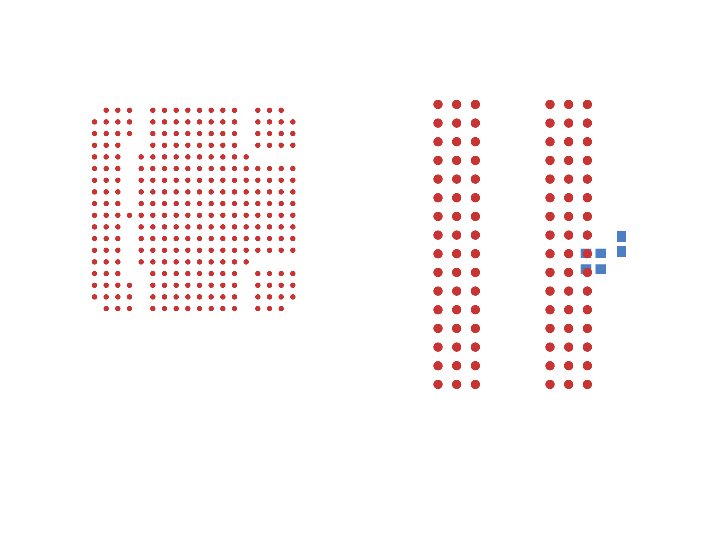

# Real OrangeCrab DDR byte-zero tuning reproduction

This is the DDR signal subsystem of [OrangeCrab r0.2.1](https://github.com/orangecrab-fpga/orangecrab-hardware/blob/c511d569fe2af39467041f888bc231020f40c6ac/hardware/orangecrab_r0.2.1/OrangeCrab.kicad_pcb), rebuilt as TSX and rendered with the published `tscircuit@0.0.3044` / core `0.0.2242`.

The five source footprints retain their original placements and all 387 pads. All 51 selected DDR nets remain declared. Only byte zero is requested: eight data lines, mask, and the two DQS conductors, on inner1. Existing copper, unrelated circuitry and power delivery are omitted. This is a byte-lane reproduction, not a complete routed DDR interface.

The experiment keeps 0.089 mm trace width and clearance, 0.28/0.15 mm vias, byte skew ≤0.5 mm and pair skew ≤0.1 mm. Timing targets are routing experiment constraints, not manufacturer timing qualification.

## Reproduce

Install the repository dependencies first with `bun install`. Then, from this directory:

```sh
npm ci --ignore-scripts --legacy-peer-deps
bun run.tsx before /absolute/path/to/base-checkout/lib/index.ts
bun validate.ts before
bun run.tsx after /absolute/path/to/fix-checkout/lib/index.ts
bun validate.ts after
```

The default solver argument is this checkout's `../../lib/index.ts`. The local algorithm adapter runs a fresh solver for each request and returns its routes to core through `autoroutingphase.algorithmFn`; no saved routes are replayed. Core publishes the resulting Circuit JSON, which the official `circuit-to-svg` renderer converts to the SVG. The wrapper retains all non-byte-zero traces as pending source connections.

The nested package pins the published core runtime. Its only override uses the same official npm `@tscircuit/jscad@0.0.3` artifact because the original CAD download host is unavailable in the capture environment. The solver, geometry and matching constraints are not patched in that runtime.

`validate.ts` independently checks all 22 source endpoints, native copper DRC, core clearance/self-short checks, whole-copper bus/pair skew, and exterior coupling before exporting any nonempty routed snapshot. `results/` holds local inputs, actual Circuit JSON, output SRJ, solver state, checks and SVG/PNG files.

## Baseline

Bus solver `791e0b67fb3519a87fb296447905ccd4fafa83f8` fails with `No shared tuning corridor`. Core publishes zero PCB routes.



[Before SVG](before.snap.svg). This is explicitly failed output, included to show the requested before/after comparison. It does not show a completed route.

The independently captured SRJ fixture in `tests/fixtures/orangecrab-core-byte0/input.srj.json` and the source geometry are immutable. The two expected-failure tests reproduce the real byte-lane failure and the underlying paired-arc clearance error. The stacked fix removes the expected-failure markers while retaining the assertions.

## Cause

The rounded pair uses offset circle samples. Straight chords between those samples have a smaller separation than the ideal curves: the 0.089 mm edge-gap case reaches approximately 0.08883058344 mm. Continuous copper checks correctly reject those candidates. Intersections of successive tangents preserve the requested spacing along the actual straight copper segments.

## Source and license

Native PCB commit: `c511d569fe2af39467041f888bc231020f40c6ac`; SHA-256: `4597f3ac08e21c09253b27ca1b9e26aaf3c3d3e2147b6c0d79c0dc6aa555e201`. Source coordinates are millimeters, footprint-local +Y down, converted by composed transforms to board-world +Y up. BGA balls remain circles; rounded rectangular passive pads use conservative rectangles.

The hardware extraction modifies the original representation and scope. It is derived from OrangeCrab under [CERN OHL v1.2](LICENSE.hardware.txt); the original design remains available at the pinned source link.

Benchmark effect: this reproduction changes no production solver behavior. Its new expected-failure tests and capture files do not alter AM3352 benchmark inputs, harness, budgets or acceptance rules. Fresh benchmark comparisons are run separately by the required workflow.
