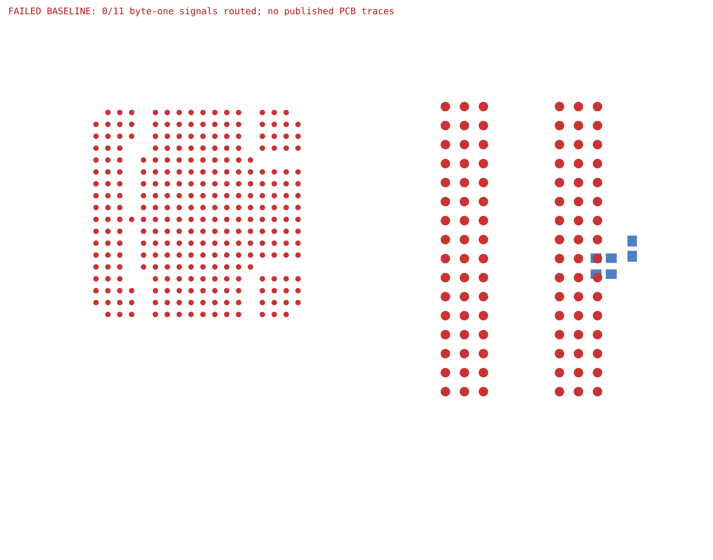

# OrangeCrab DDR byte-one routing reproduction

The real [OrangeCrab r0.2.1](https://github.com/orangecrab-fpga/orangecrab-hardware/blob/c511d569fe2af39467041f888bc231020f40c6ac/hardware/orangecrab_r0.2.1/OrangeCrab.kicad_pcb) DDR subsystem, rendered through published `tscircuit@0.0.3046` / core `0.0.2244`. This reuses the [original TSX and footprint extraction](../orangecrab-byte0/circuits/orangecrab.tsx): all 387 pads and 51 selected DDR nets remain declared. Only byte one is routed: D8–D15, UDM and UDQS± on inner2.

The router connects the lane, then fails length matching with `No shared tuning corridor`. It stops without trying the other available ordinary-lane orders. The stacked fix retries those orders while retaining the paired corridor, supplied copper and the existing search budget.



The reproduction PR deliberately records the labeled failed baseline here. The fix replaces this same SVG with completed, independently checked core output, giving GitHub a visual diff. The exported input is captured unchanged in [the regression fixture](../../tests/fixtures/orangecrab-core-byte1/input.srj.json).

```sh
# Install repository dependencies, then run from this directory.
npm ci --ignore-scripts --legacy-peer-deps
bun run.tsx before /absolute/path/to/base/lib/index.ts
bun failed-baseline.ts before
bun run.tsx after /absolute/path/to/fix/lib/index.ts
bun validate.ts after
```

The algorithm adapter runs a fresh solver and returns its traces through core's normal routing lifecycle. No routes are replayed. Both runs keep the same TSX, placement, source nets, 0.089 mm trace width/clearance, 0.28/0.15 mm vias, 0.5 mm byte skew and 0.1 mm pair skew. The CAD-only override selects the official npm package because its usual download host is unavailable in the capture environment.

`validate.ts` requires all 11 traces, all 22 endpoints, native DRC, core clearance/self-short checks, bus/pair matching and exterior coupling before exporting a completed image. `failed-baseline.ts` accepts only this input hash and this failure. Timing constraints are experimental; existing copper, power delivery and unrelated circuitry are omitted. Routing this byte alone does not establish a routed or timing-qualified DDR interface.

The measured result is retained in [comparison.json](comparison.json).

The source coordinates and hardware license are documented in the [shared source reproduction](../orangecrab-byte0/README.md#source-and-license); the extraction is derived from OrangeCrab under [CERN OHL v1.2](../orangecrab-byte0/LICENSE.hardware.txt).
