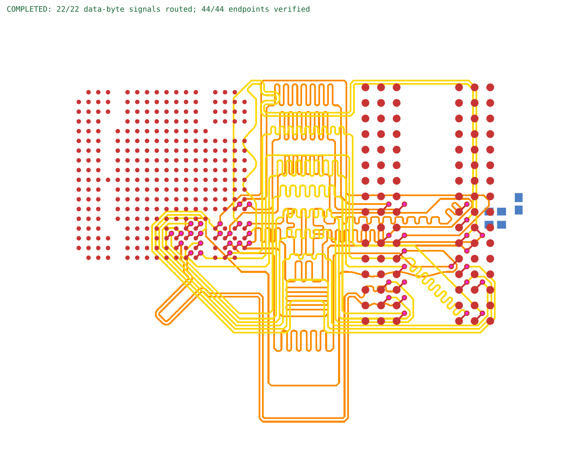

# OrangeCrab two-byte DDR reproduction

Routes both data bytes of the real [OrangeCrab r0.2.1](../orangecrab-byte0/README.md#source-and-license) through published `tscircuit@0.0.3047` / core `0.0.2245`. It reuses the original extracted TSX: all 387 pads and 51 source traces remain declared. Both byte groups share one routing phase, with byte zero on inner1 and byte one on inner2.

Main times out after 120 seconds with **0/22 traces**. The fix reserves all 44 escape vias together, searches the separate carrier layers with fresh small-bus solvers, and retries a different DQS package entry when the first matched route fails exterior coupling. The same TSX/core request then publishes **22/22 traces and 44 vias**.

The captured completed run has 44/44 connected endpoints, zero native/core physical errors, byte skews of 0.4851/0.5000 mm and DQS skews below 0.1 mm. Both DQS pairs remain coupled outside their package approaches. [Measured comparison](comparison.json).



The repro deliberately tracks this labeled failed baseline. A completed result must pass the original endpoint, copper clearance, self-short, byte skew, pair skew and exterior coupling checks before replacing the same SVG. The renderer consumes actual core Circuit JSON.

```sh
# Install repository dependencies, then run from this directory.
npm ci --ignore-scripts --legacy-peer-deps
bun run.tsx before /absolute/path/to/base/lib/index.ts
bun failed-baseline.ts before
bun run.tsx after /absolute/path/to/fix/lib/index.ts
bun validate.ts after
```

Both runs use the same TSX, 0.0889 mm traces, 0.089 mm clearance, 0.28/0.15 mm through-vias, 0.5 mm byte skew, 0.1 mm DQS skew and 120-second solver budget. The adapter computes fresh routes and returns them through core's routing lifecycle. It never replays saved copper. The CAD-only override uses the official npm package because the normal download host is unavailable in the capture environment.

The exact exported input and source provenance are in [the regression fixture](../../tests/fixtures/orangecrab-core-data-bytes/provenance.json). The source hardware is under [CERN OHL v1.2](../orangecrab-byte0/LICENSE.hardware.txt). This experiment covers the two data bytes; address, command, clocks, termination and power still need routing and electrical timing analysis.
