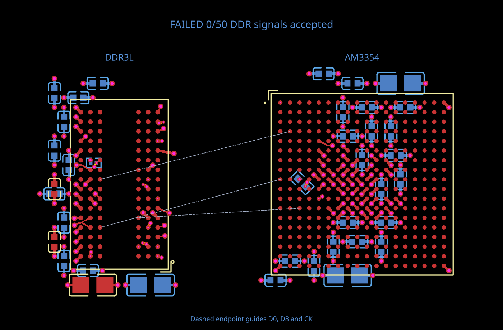

# Pixel Dash populated AM3354 DDR3L channel

The AM3354 and x16 DDR3L packages route all 50 signals in the package-only control on BusLanes 0.0.51. With the support components and copper from the same four-layer calibration layout in place, the solver exhausts its negotiation pass budget. BusLanes 0.0.62 and 0.0.63 reach the 240-second connectivity budget on the populated input.



Run the regression from the repository root.

```sh
bun install
bun test tests/pixel-dash-am3354-populated.test.ts
```

The test snapshots the fixed PCB geometry and reports the solver failure. Once the solver returns all 50 named nets, the test checks all 100 endpoints and copper DRC before drawing the accepted routes. Use Bun’s `-u` flag to refresh the snapshot for a fix. The standalone command remains available as `bun repros/pixel-dash-am3354-populated/run.ts`.

The input retains 1,577 obstacles, including the package pads, inner-layer no-via-in-pad exclusions for signal escape, bypass and calibration pads, fixed copper segments with round ends, and the remaining vias on their physical layers. The 50 requested DDR paths and their 100 vias have been removed. The snapshot shows the physical pads, 169 remaining vias and 160 fixed traces. Three dashed guides connect the requested D0, D8 and CK endpoints. The calibration checkpoint predates the VREF divider. The solver uses a bottom signal carrier, 0.102 mm traces, and 0.4572 mm signal via lands with 0.254 mm drills. Continuous reference pours are outside this solver input. [Fixture and capture provenance](../../tests/fixtures/pixel-dash-am3354-populated/)
