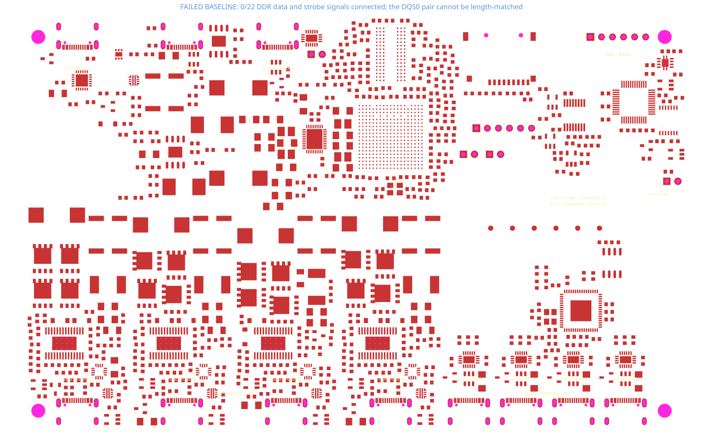
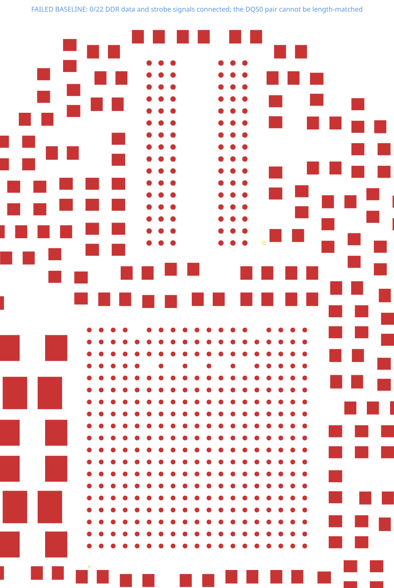

# STM32MP157D DDR data bytes with DQS pairs

The same six-layer STM32MP157D motherboard as [the reserved-plane reproduction](../stm32mp157d-reserved-plane-vias) ([tscircuit package](https://tscircuit.com/MustafaMulla29/four-motor-usbc-stm32mp157d)). Here its unchanged `bus_lanes` phase requests both DDR data bytes with their strobes: DQ0–DQ15, DQM0–DQM1 and the DQS0/DQS1 differential pairs between U70 and its DDR3L U71, on inner3.

With the reserved-plane via fix, native routing gets past the strobe approaches and stops at the DQS0 pair. Each DQS pair leaves U70 side by side on its edge row and enters U71 stacked inside the ball grid, so its straight rails differ by 1.12 mm against a 0.25 mm pair tolerance. Pair refinement fails every native plan: six with `Insufficient tuning clearance for source_trace_16` and one with `No clear conventional approach corners`. No DQ signal is attempted.

The regression uses the [exact Core phase input and Circuit JSON](../../tests/fixtures/stm32mp157d-ddr-dqs-pair-tuning). Its two SVGs show the whole board and a close-up of the U70–U71 area. The failed baseline shows native pads and no candidate copper; the stacked fix updates the same SVGs after connectivity, matching and DRC pass.





```sh
bun test tests/stm32mp157d-ddr-dqs-pair-tuning.test.ts --timeout 300000
```

[Capture provenance](../../tests/fixtures/stm32mp157d-ddr-dqs-pair-tuning/provenance.json).
