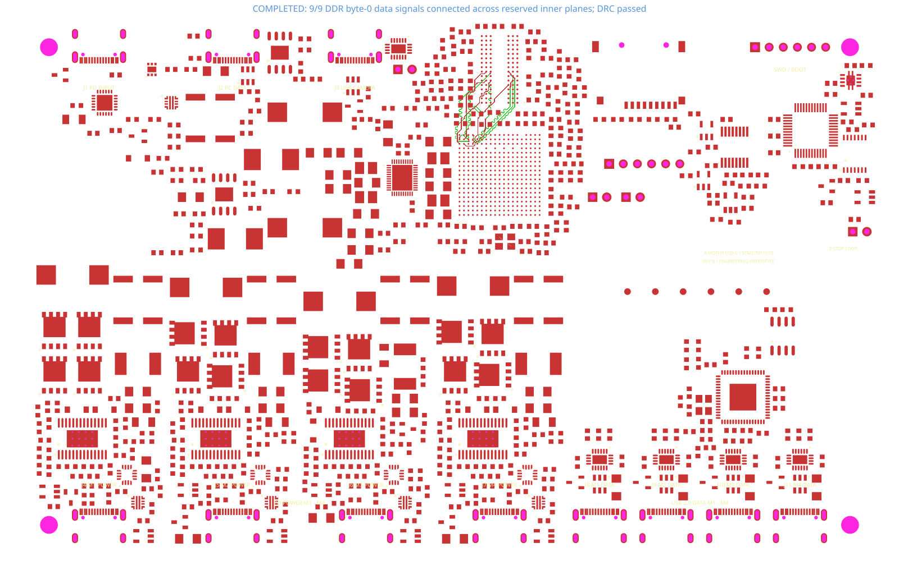
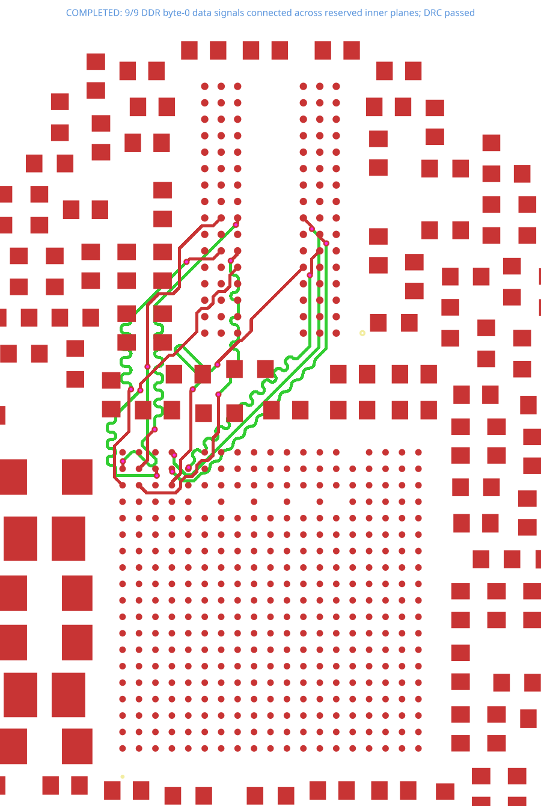

# STM32MP157D DDR byte across reserved inner planes

A six-layer STM32MP157D motherboard ([tscircuit package](https://tscircuit.com/MustafaMulla29/four-motor-usbc-stm32mp157d)) reserves unbroken copper pours under both BGAs: GND on inner1, MPU_CORE and DDR1V35 on inner2, and SYS3V3 and MPU3V3 on inner4. Its `bus_lanes` phase requests DDR byte 0 data (DQ0–DQ7 and DQM0) between the STM32MP157D (U70) and its DDR3L (U71) on inner3.

Published `tscircuit@0.0.3285` / core `0.0.2462` / bus-lanes-solver `0.0.65` routes none of the nine signals and fails with `Native carrier matching exhausted its routing plans`. Every top-to-inner3 signal via crosses the reserved planes. With the pour obstacles removed from the same input, the same solver routes all nine, so the planes alone block the via sites.

The regression uses the [exact Core phase input and Circuit JSON](../../tests/fixtures/stm32mp157d-reserved-plane-vias). Its two SVGs show the whole board and a close-up of the U70–U71 area to be routed. The failed baseline shows native pads and no candidate copper; the stacked fix updates the same SVGs after connectivity and DRC pass.





```sh
bun test tests/stm32mp157d-reserved-plane-vias.test.ts --timeout 120000
```

[Capture provenance](../../tests/fixtures/stm32mp157d-reserved-plane-vias/provenance.json). The capture keeps every pour, placement and design rule; no length-matching or impedance constraints are added.
